<div align="center">

# 拾光MV

**面向影楼写真、蛋糕烘焙门店的桌面端 MV 制作软件**

导入照片 → 选模板 → 自动卡点成片 → 精修 → 批量导出

Electron · React · WebGL2 · WebCodecs · MediaPipe

[⬇ 下载 macOS 版](https://github.com/DCdafan/mv/releases/latest)

&nbsp;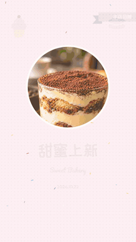

<sub>软件直接导出的成片片段：左为婚纱「纯白誓言」模板（横屏），右为蛋糕店「甜蜜烘焙」模板（竖屏，品名和价格取自照片文件名）</sub>

</div>

---

## 目录

- [为什么做这个](#为什么做这个)
- [功能一览](#功能一览)
- [界面截图](#界面截图)
- [模板](#模板)
- [蛋糕店场景](#蛋糕店场景)
- [性能](#性能)
- [安装与运行](#安装与运行)
- [项目结构](#项目结构)
- [新增一套模板](#新增一套模板)
- [测试](#测试)
- [素材与授权](#素材与授权)
- [路线图](#路线图)

更多文档：[产品设计与对标分析](docs/产品设计.md) · [技术架构](docs/技术架构.md) · [模板图鉴](docs/模板图鉴.md)

## 为什么做这个

国内影楼做 MV 电子相册，过去十几年主要靠 ProShow Producer（俗称"PSP 影楼模板"），它停更后，大家转向 SmartSHOW 3D、会声会影模板，或者手机上的一键成片 App。影楼的需求和普通用户不太一样：

| 影楼的痛点 | 拾光MV 的做法 |
|---|---|
| 一个客户 50～300 张精修片，一天要出很多客户 | **批量出片**：一个文件夹一个客户，自动分析、编排、排队导出 |
| 选片靠人眼，容易漏掉闭眼、糊片、重复片 | **智能选片**：人脸 / 闭眼检测、模糊检测、重复检测、综合评分 |
| 套模板后还要手动对齐音乐节拍 | **自动卡点**：分析节拍和重拍，转场落在鼓点上，高潮段节奏更快 |
| 片尾要带影楼名称、电话，画面要水印 | **品牌设置**：一次设置，所有模板片尾自动带上 |
| 横屏给电视大屏，竖屏发抖音和朋友圈 | **多画幅**：同一模板自动适配 16:9 / 9:16 / 1:1 / 4:3 |
| 原图动辄 20MB 以上，导出慢 | **本地硬件编码**：预览用代理图，导出用 WebCodecs 硬件 H.264 |

同样的能力也适合**蛋糕店、烘焙甜品店**做新品宣传和门店推广，见[蛋糕店场景](#蛋糕店场景)。

## 功能一览

**智能成片**
- 4 步向导：导入照片 → 选模板 → 选音乐 → 填写信息，一键生成
- 自动为每张照片挑选合适的版式（横图、竖图分别匹配），推拉摇移的运镜朝人脸推进
- 自动配字幕：每套模板自带一组文案，可逐条修改

**智能选片**
- 人脸检测 + 闭眼识别（MediaPipe Face Landmarker）
- 模糊检测（拉普拉斯方差，按同批照片相对比较）
- 重复照片检测（感知哈希 dHash）
- 过暗 / 过曝检查、EXIF 拍摄时间排序、HEIC 自动转换（macOS）
- 从文件名识别商品：`草莓奶油蛋糕-168.jpg` → 品名「草莓奶油蛋糕」、价格「￥168」

**音乐卡点**
- 自研节拍追踪：频谱通量 → 自相关估计速度 → 动态规划节拍追踪 → 4/4 拍重拍 → 能量曲线
- 场景切换对齐节拍，尽量落在小节线上；能量高的段落换片更快
- 两种时长模式：按照片数量（音乐自动淡出）/ 跟随整首歌长度

**编辑器**
- WebGL 实时预览，预览与导出使用同一套渲染代码，所见即所得
- 时间线：场景缩略图、转场标记、音乐波形、节拍与重拍刻度、拖拽排序、拖入照片替换
- 场景属性：切换版式（含不同张数的版式）、替换照片、点选画面焦点、按拍增减时长、选择转场与时长、编辑字幕
- 一键换模板 / 换音乐 / 换画幅 / 换节奏，「换一换」重新随机编排
- 撤销 / 重做、自动保存、快捷键（空格播放、⌘Z、⇧← → 跳场景、Delete 删除场景）

**导出**
- 720p / 1080p / 2K / 4K，25 / 30 / 60 fps，三档画质
- 后台导出队列：导出时可以继续编辑其他项目，完成后系统通知
- 隐藏窗口逐帧渲染 → WebCodecs 硬件 H.264 → mp4-muxer 封装 → FFmpeg 合成 AAC 音轨（含淡入淡出）

**批量出片与品牌**
- 选择一个总目录，每个子文件夹生成一个独立项目并排队导出
- 统一设置模板、音乐、画幅、节奏、分辨率；片头标题可直接用文件夹名（客户名）
- 店铺名称、口号、电话（预约热线 / 订购热线可选）、门店地址自动出现在所有模板片尾，可选全程角标水印

## 界面截图

### 首页


### 新建向导

| 导入照片：自动标出重复、模糊、闭眼 | 选择模板：用你自己的照片实时渲染预览 |
|---|---|
| 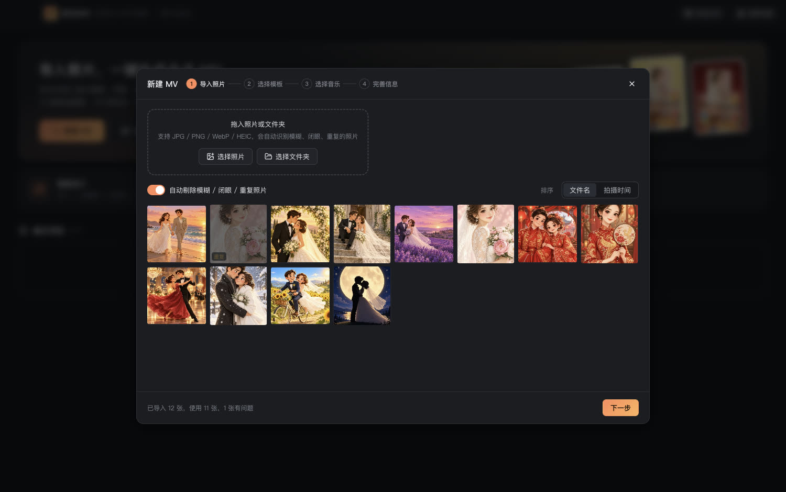 |  |
| **选择音乐：内置免版权曲库，可导入本地音乐** | **完善信息：标题、日期、画幅、节奏、时长模式** |
| 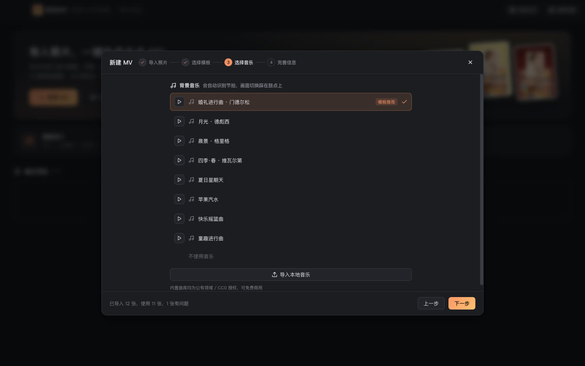 | 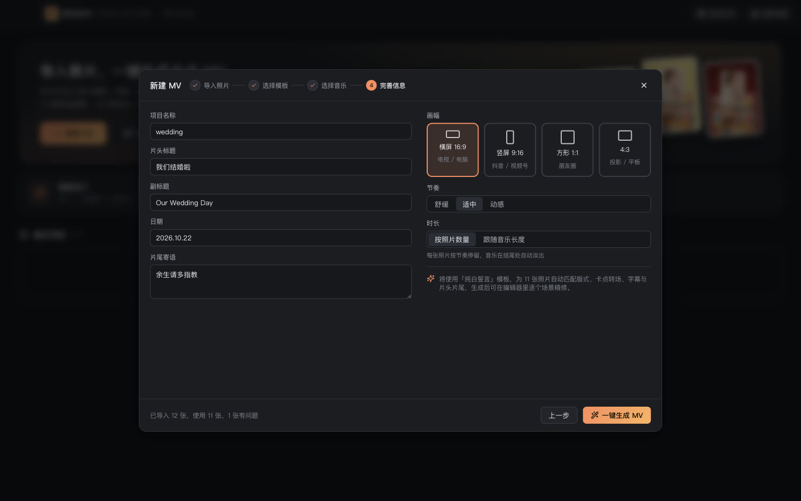 |

### 编辑器

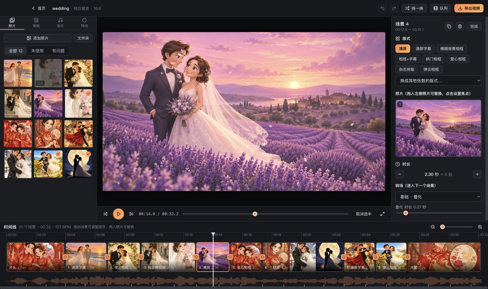

<sub>左：照片库（✓ 已使用、问题标记）· 中：实时预览 · 右：场景属性（版式、照片焦点、按拍调时长、转场）· 下：时间线（场景、转场、音乐波形与节拍刻度）</sub>

| 转场面板（26 种） | 音乐面板（节拍信息、音量、起点、重新卡点） | 模板面板（一键切换） |
|---|---|---|
| 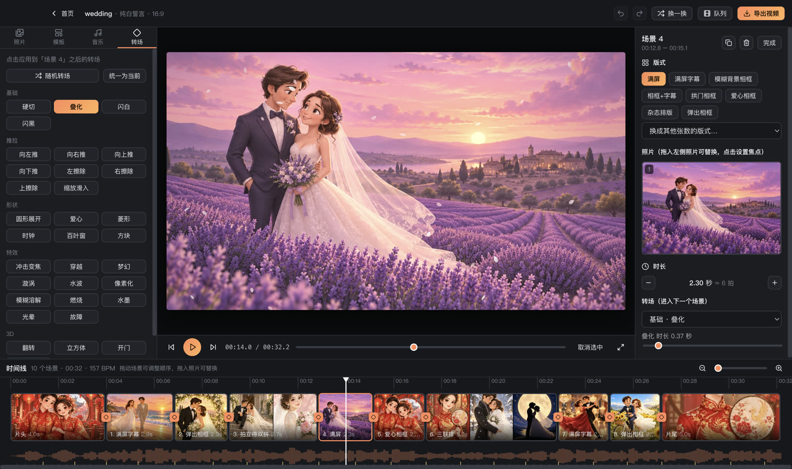 | 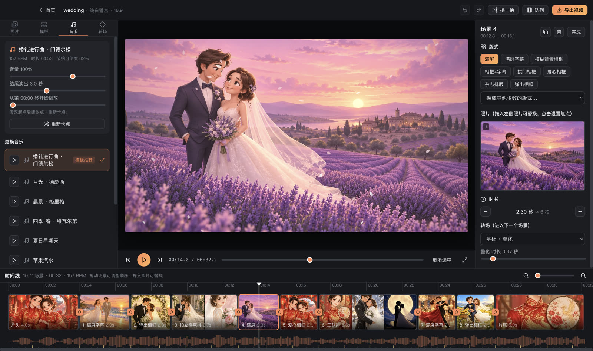 | 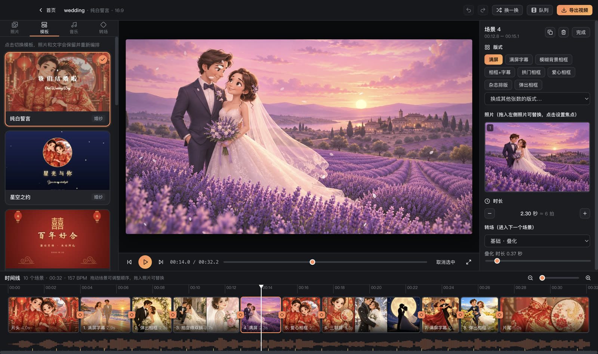 |

### 导出与批量出片

| 导出设置 | 导出队列 |
|---|---|
| 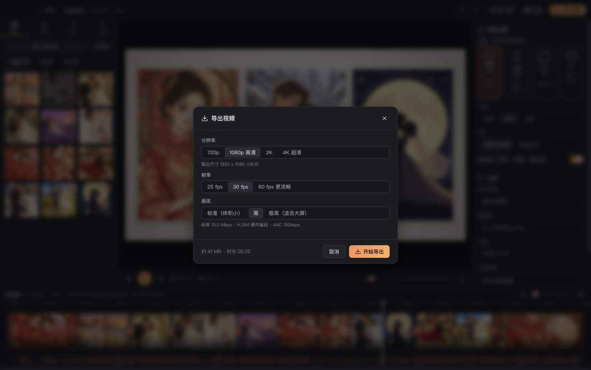 | 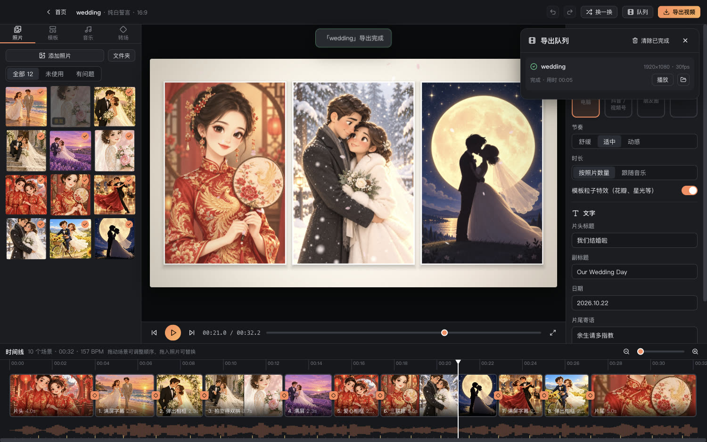 |

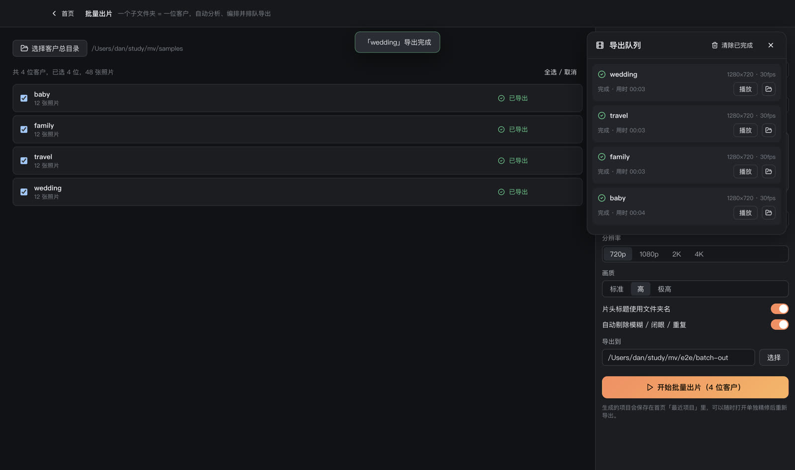

<sub>批量出片：4 位客户、48 张照片，从分析到全部导出 720p 共 17 秒</sub>

## 模板

13 套模板，覆盖婚纱、中式、写真、儿童、旅行、家庭、毕业、烘焙。每套模板包含片头、片尾和 6～12 种版式，自带配色、字体、调色、粒子特效、转场组合、推荐音乐和文案。

**片头**


**正片版式**

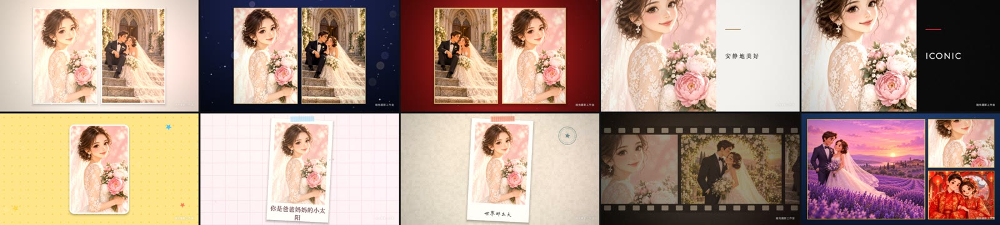

**竖屏 9:16（同一套模板自动适配）**

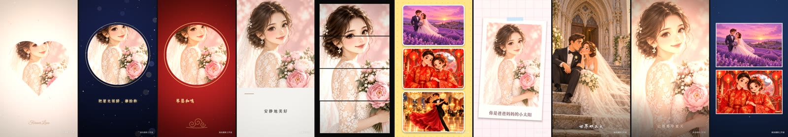

| 模板 | 分类 | 风格 | 推荐音乐 |
|---|---|---|---|
| 纯白誓言 | 婚纱 | 奶油白、花瓣飘落、柔光暖调、拱门 / 爱心相框 | 婚礼进行曲 |
| 星空之约 | 婚纱 | 深蓝夜空、星光与金色光斑、金边相框 | 月光 |
| 中式喜嫁 | 中式 | 正红鎏金、囍字灯笼祥云、团扇相框、水墨转场 | 四季·春 |
| 光影写真 | 写真 | 留白杂志风、细线条、衬线字体 | 月光 |
| 时尚大片 | 写真 | 黑白高对比 + 红色点缀、粗体排版、故障快切 | 夏日星期天 |
| 童趣乐园 | 儿童 | 撞色波点、气球星星、圆角相框弹跳入场 | 童趣进行曲 |
| 宝宝成长记 | 儿童 | 马卡龙色、拍立得与胶带、爱心飘升 | 快乐摇篮曲 |
| 旅行日记 | 旅行 | 牛皮纸手账、拍立得、邮戳、纸飞机、手写体 | 苹果汽水 |
| 胶片回忆 | 家庭 | 复古胶片调色、颗粒漏光、胶片条、行书 | 晨景 |
| 青春不散场 | 毕业 | 藏青与金、彩纸纷飞、学士帽与月桂 | 四季·春 |
| 甜蜜烘焙 | 烘焙 | 粉色波点、彩色糖粒、纸杯蛋糕与马卡龙、价格爆炸贴 | 夏日星期天 |
| 新品上市 | 烘焙 | 红黄撞色促销风、价格爆炸贴、快节奏转场 | 苹果汽水 |
| 法式下午茶 | 烘焙 | 奶油纸纹、鼠尾草绿与金色细线、衬线体菜单排版 | 晨景 |

每套模板所有场景的效果见 [模板图鉴](docs/模板图鉴.md)。

## 蛋糕店场景

蛋糕店、烘焙甜品店做 MV 的目的和影楼不同：主要是**新品宣传、门店推广**，发抖音、视频号、朋友圈，或者放在门店大屏上循环播放。重点是让顾客一眼看到「是什么、多少钱、在哪买」。

**1. 照片按「品名-价格」命名，导入时自动识别**

| 文件名 | 识别结果 |
|---|---|
| `草莓奶油蛋糕-168.jpg` | 品名：草莓奶油蛋糕　价格：￥168 |
| `抹茶慕斯 ¥36.jpg` | 品名：抹茶慕斯　价格：￥36 |
| `黄油可颂_18元.png` | 品名：黄油可颂　价格：￥18 |
| `门店环境.jpg` | 品名：门店环境（没有价格，不进产品版式） |
| `IMG_1234.jpg` | 不识别（相机默认文件名） |

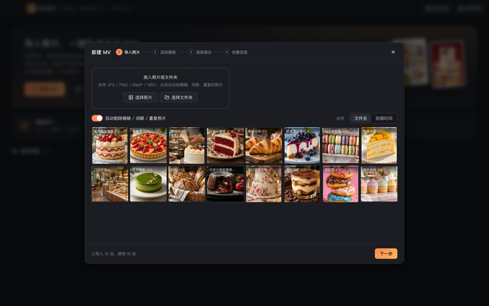

大部分照片带价格时，新建向导会自动选中蛋糕店模板，并默认竖屏 9:16。

**2. 专门的产品版式**

- **产品卡**：大图 + 品名 + 价格爆炸贴 / 价格胶囊，可加「本店招牌」「新品上市」丝带标签
- **产品大图**：满屏产品照，底部品名和价格
- **菜单板**：三款产品并排，各带品名和价格，适合门店大屏

带价格的照片优先进入产品版式；门店环境、烘焙师裱花这类没有价格的照片会自动分到普通版式，不会出现空的价格标签。

**3. 3 套蛋糕店模板（竖屏）**


<sub>从左到右每 4 张一组：甜蜜烘焙、新品上市、法式下午茶</sub>

**横屏（门店大屏、电视）**


**4. 在编辑器里逐个场景修改品名、价格、标签**

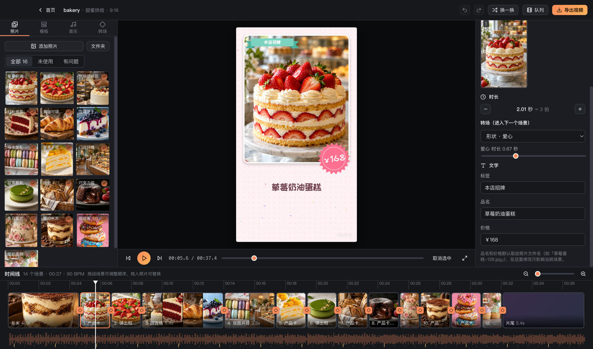

<sub>右侧「文字」区自动填好了从文件名识别的品名和价格，修改只影响当前场景；清空价格即隐藏价格贴纸</sub>

**5. 片尾自动带上店铺信息**：在「品牌设置」里填写店名、口号、订购热线和门店地址。

## 性能

测试机：MacBook Pro M3 Pro。

| 项目 | 数据 |
|---|---|
| 照片导入分析（12 张，含人脸、清晰度、重复检测、生成代理图） | 约 1～5 秒 |
| 节拍分析（一首 4 分钟歌曲） | 约 0.2 秒 |
| 导出 1080p 30fps（32 秒成片） | 7 秒，约 190 帧/秒 |
| 导出 4K 30fps（32 秒成片） | 20 秒，约 54 帧/秒 |
| 批量出片（4 位客户 × 12 张，720p） | 17 秒 |

## 安装与运行

### 直接下载

**[下载 macOS 安装包（Apple 芯片）](https://github.com/DCdafan/mv/releases/latest)**：打开 Releases 页面下载 `ShiguangMV-x.x.x-arm64.dmg`。安装包未签名，首次打开请在「应用程序」里右键 →「打开」。

### 从源码运行

需要 Node.js 20+。

```bash
git clone https://github.com/DCdafan/mv.git
cd mv
npm install
npm run dev
```

打包 macOS 安装包（Apple 芯片，未签名，首次打开需右键 →「打开」）：

```bash
npm run dist:mac
```

产物在 `dist/拾光MV-1.0.0-arm64.dmg`。FFmpeg 由 `ffmpeg-static` 随安装包分发，用户无需另外安装。

## 项目结构

```
src/
  main/               主进程
    index.ts            窗口、mvfile:// 本地文件协议、app:// 界面协议、IPC
    store.ts            项目 / 设置存储、内置曲库
    exporter.ts         导出队列：隐藏渲染窗口 + FFmpeg 合成音轨
  preload/            暴露给界面的 API（window.mv）
  shared/types.ts     项目数据模型
  renderer/
    index.html          主界面
    render.html         导出渲染窗口
    src/
      engine/             WebGL2 渲染引擎
        renderer.ts         场景、图层、转场、后期的总调度
        shaders.ts          图层着色器（遮罩 SDF、调色）、后期着色器
        transitions.ts      26 种 GLSL 转场
        particles.ts        确定性粒子系统
        anim.ts             入场 / 出场 / 循环动画、推拉摇移
        text.ts / decor.ts  文字排版、程序化装饰素材
      templates/          版式库 styles.ts + 10 套模板
      analysis/           节拍分析（Web Worker）、照片分析
      arrange/            自动编排
      ui/                 界面组件
      render-main.ts      导出：逐帧渲染 + WebCodecs 编码
resources/music/      内置曲库（公有领域 / CC0）
samples/              测试照片（AI 生成，bakery/ 为蛋糕店商品图）
tests/                单元测试
e2e/                  端到端测试脚本
docs/                 文档
```

技术细节见 [技术架构](docs/技术架构.md)。

## 新增一套模板

模板是数据 + 版式工厂的组合，不需要改渲染引擎。在 `src/renderer/src/templates/` 新建或修改文件：

```ts
export const myTemplate: Template = {
  id: 'my-template',
  name: '我的模板',
  category: '婚纱',
  description: '一句话描述',
  tags: ['婚纱'],
  palette: { bg: '#f6efe7', primary: '#c9a27e', accent: '#e8b4b8', text: '#5b4636', textSoft: '#9a8573' },
  fonts: { title: 'ZCOOLXiaoWei', body: 'ZCOOLXiaoWei', script: 'GreatVibes' },
  grade: { warmth: 0.2, saturation: 0.95 },             // 调色
  post: { vignette: 0.2, grain: 0.01, leak: 0.1 },       // 暗角、颗粒、漏光
  background: { kind: 'radial', colors: ['#fffaf4', '#efe3d6'] },
  overlay: [{ type: 'petals', count: 24, colors: ['#ffffff', '#ffd6e0'] }],
  transitions: [{ name: 'fade', weight: 3 }, { name: 'heart', weight: 1 }],
  music: 'wedding-march.mp3',
  pace: 'normal',
  intro: intro({ id: 'my-intro', titleStyle: ..., subStyle: ... }),
  outro: outro({ id: 'my-outro', endStyle: ..., smallStyle: ... }),
  styles: [
    fullscreen({ id: 'my-full' }),
    blurFrame({ id: 'my-blur', border: { width: 0.01, color: '#fff' } }),
    duo({ id: 'my-duo' }),
    polaroid({ id: 'my-pola', caption: ts('LongCang', 0.05, '#333') })
  ],
  captions: ['遇见你，是最美的意外'],
  defaults: { title: '我们结婚啦', subtitle: 'Our Wedding Day', ending: '余生请多指教' },
  coverColors: ['#f6efe7', '#e8b4b8']
}
```

然后加到 `templates/index.ts` 的 `TEMPLATES` 列表里。可用的版式工厂（`styles.ts`）：

| 工厂 | 说明 | 照片数 |
|---|---|---|
| `fullscreen` | 满屏 + 推拉摇移，可选底部字幕 | 1 |
| `blurFrame` | 模糊背景 + 相框，可放字幕在侧边 | 1 |
| `shapeFrame` | 圆形 / 爱心 / 拱门 / 六边形相框 | 1 |
| `polaroid` | 拍立得卡片 + 手写字幕 + 胶带 | 1 |
| `zoomPop` | 模糊背景 + 弹出相框 | 1 |
| `magazine` | 杂志排版：半图 + 大字 | 1 |
| `panes` | 一张照片切成几条错落滑入 | 1 |
| `duo` / `polaroidPair` | 双图并排 / 拍立得双拼 | 2 |
| `trio` / `heroTwo` / `stack` / `filmStrip` | 三联 / 一大两小 / 照片堆叠 / 胶片条 | 3 |
| `grid4` | 四宫格 | 4 |
| `productCard` / `productHero` | 产品卡 / 产品大图（`templates/bakery.ts`） | 1 |
| `menuBoard` | 菜单板：三款产品带品名和价格 | 3 |

文字图层的 `key` 决定内容来源：`title`、`subtitle`、`date`、`ending` 取项目信息；`studio`、`slogan`、`phone`、`address` 取店铺品牌；`product@0`、`price@0` 取第 1 张照片的品名和价格；`caption`、`tag` 可在编辑器里逐场景修改。图层加 `showIf: 'price@0'` 可以在没有价格时自动隐藏。

改完后运行 `node e2e/gallery.mjs` 可以把每个模板的每个场景渲染成总览图，用来检查效果。

## 测试

```bash
npm test              # 单元测试：节拍分析、自动编排（13 套模板 × 3 种画幅）、文件名识别商品
npm run typecheck     # 类型检查
npm run build         # 端到端测试前先构建
node e2e/smoke.mjs    # 启动真实应用：导入 → 生成 → 预览 → 导出 1080p，并用 ffprobe 校验
node e2e/batch.mjs    # 批量出片：samples 下 4 个文件夹各生成一个 MV
node e2e/gallery.mjs  # 渲染全部模板的每个场景，输出到 e2e/gallery
```

端到端测试用 Playwright 驱动 Electron，在主进程里替换文件选择框，数据写到独立目录，不会影响本机的真实项目。

## 素材与授权

| 素材 | 来源 | 授权 |
|---|---|---|
| 内置音乐 8 首 | Wikimedia Commons、OpenGameArt | 公有领域 / CC0，详见 [resources/music/LICENSES.md](resources/music/LICENSES.md) |
| 字体 10 款 | Google Fonts | SIL Open Font License 1.1 |
| 人脸模型、WASM | Google MediaPipe | Apache 2.0 |
| 测试照片 64 张（含 16 张蛋糕） | AI 生成（`assets-gen/scripts`） | 仅供测试 |
| 装饰素材 | 程序绘制（`engine/decor.ts`） | 本项目 |

## 路线图

- [ ] Windows 安装包与代码签名
- [ ] 用真实影楼客片调优人脸焦点与调色
- [ ] 模板可视化编辑器（设计师不写代码出模板）
- [ ] 片尾影楼 Logo 图片
- [ ] 照片 3D 视差（深度估计）、AI 图生视频
- [ ] 云端模板下发
